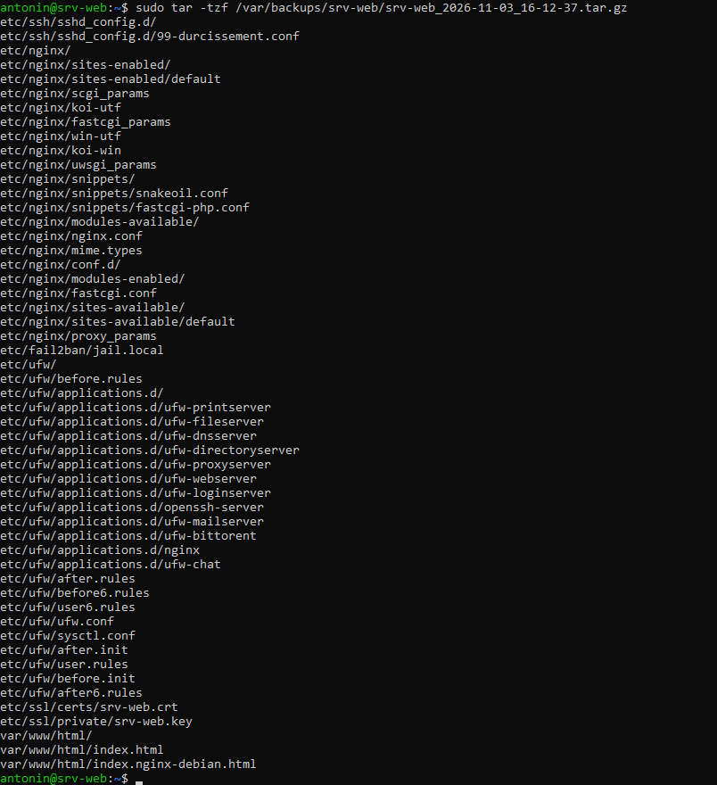
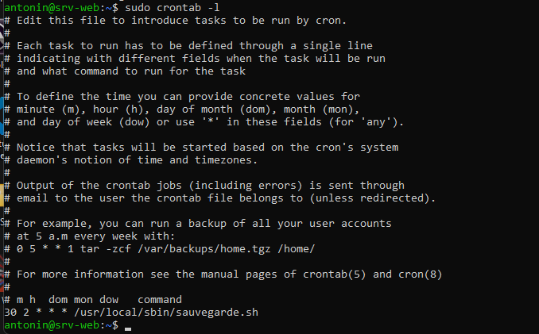
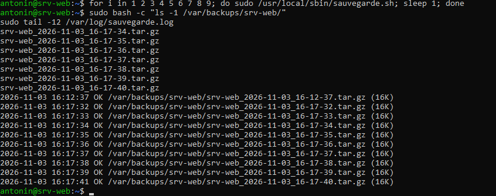
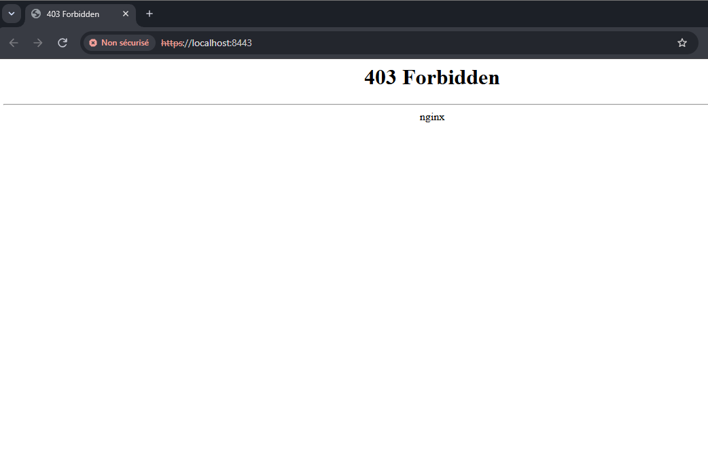
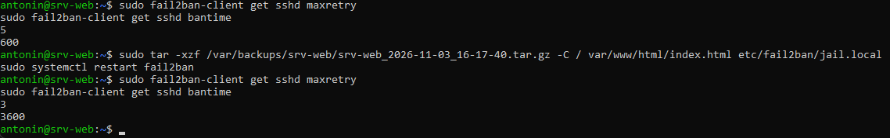
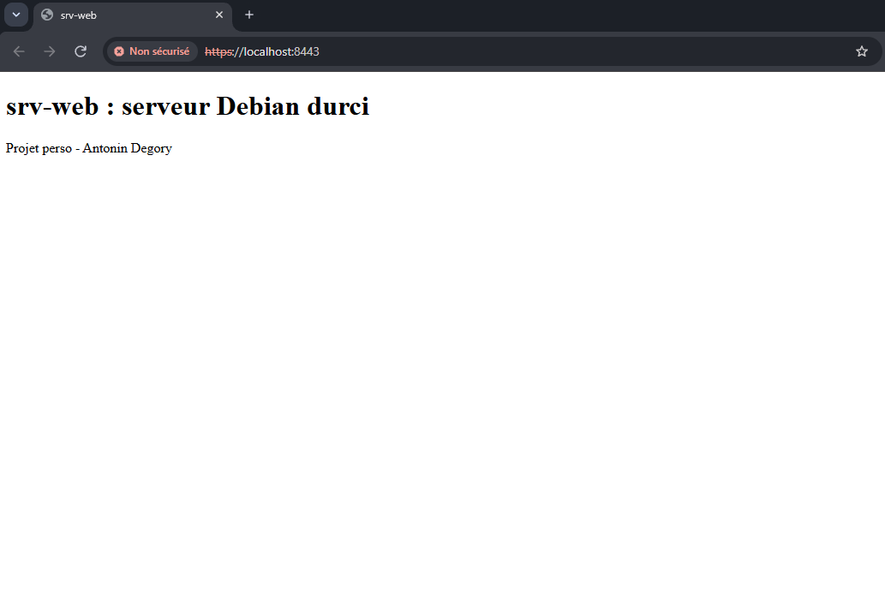

# Sauvegarde automatique de srv-web

Projet personnel : un script Bash qui sauvegarde chaque nuit la configuration et le site de mon serveur
[srv-web](https://github.com/antonindgr/srv-web-debian-durci), garde les 7 dernières copies, et une
restauration testée après une panne simulée.

Réalisé par Antonin Degory, BTS SIO option SISR (2026-2028), ENSITECH Saint-Quentin-en-Yvelines, novembre 2026.

## Pourquoi ce projet

Après avoir sécurisé srv-web (SSH par clé, pare-feu, HTTPS, Fail2ban), il manquait une chose : pouvoir
tout récupérer après une erreur, une panne ou une attaque. Un serveur sans sauvegarde testée n'est pas fini.

## Ce qui est sauvegardé

| Élément | Chemin |
|---|---|
| Durcissement SSH | `/etc/ssh/sshd_config.d/` |
| Serveur web | `/etc/nginx/` |
| Fail2ban | `/etc/fail2ban/jail.local` |
| Pare-feu | `/etc/ufw/` |
| Certificat HTTPS et sa clé | `/etc/ssl/certs/srv-web.crt`, `/etc/ssl/private/srv-web.key` |
| Site web | `/var/www/html/` |

## Fonctionnement

Le script [`scripts/sauvegarde.sh`](scripts/sauvegarde.sh) est installé dans `/usr/local/sbin/` et lancé
par cron tous les jours à 2 h 30 ([`scripts/crontab-root.txt`](scripts/crontab-root.txt)). À chaque lancement :

1. il crée une archive `srv-web_AAAA-MM-JJ_HH-MM-SS.tar.gz` dans `/var/backups/srv-web/` ;
2. il **relit l'archive** pour vérifier qu'elle n'est pas corrompue ;
3. il **supprime les plus anciennes** pour n'en garder que 7 (une semaine) ;
4. il écrit une ligne **OK** (ou **ECHEC** avec le numéro de ligne) dans `/var/log/sauvegarde.log`.

### Choix techniques

- `set -euo pipefail` : le script s'arrête à la première erreur au lieu de produire une sauvegarde incomplète.
- `umask 077` : les archives ne sont lisibles que par root, car elles contiennent la clé privée du certificat.
- `tar -C /` avec des chemins relatifs : à la restauration, chaque fichier revient exactement à sa place.
- Le script tourne dans la crontab **de root**, car il doit lire des fichiers protégés.

## Tests effectués

| Test | Résultat | Capture |
|---|---|---|
| Sauvegarde lancée à la main | Archive de 16 Ko, ligne OK dans le journal |  |
| Tâche planifiée | `sudo crontab -l` affiche la ligne de 2 h 30 |  |
| Rotation : script lancé 9 fois de suite | 10 sauvegardes OK, mais seulement les 7 plus récentes conservées |  |
| Panne simulée : suppression de la page du site | Le site répond 403 Forbidden |  |
| Panne simulée : suppression de `jail.local` | Fail2ban repasse aux réglages Debian : 5 essais, ban de 10 min |  |
| Restauration des 2 fichiers depuis la dernière archive | Site de retour, Fail2ban de nouveau à 3 essais et 1 h de ban |  |

Commande de restauration utilisée (seulement les fichiers perdus, pas toute l'archive) :

```
sudo tar -xzf /var/backups/srv-web/srv-web_2026-11-03_16-17-40.tar.gz -C / var/www/html/index.html etc/fail2ban/jail.local
sudo systemctl restart fail2ban
```

## Difficultés rencontrées

| Difficulté | Explication et solution |
|---|---|
| `sudo tar -tzf /var/backups/srv-web/srv-web_*.tar.gz` répondait « Aucun fichier ou dossier ». | Le `*` est interprété par mon shell utilisateur avant `sudo`. Or le dossier n'est lisible que par root (grâce au `umask 077`), donc mon shell ne voyait pas les fichiers. Solution : donner le nom complet, ou `sudo bash -c "..."`. C'est la preuve que les sauvegardes sont bien protégées. |
| Après la suppression de `jail.local`, la prison sshd de Fail2ban était toujours active. | Debian fournit `/etc/fail2ban/jail.d/defaults-debian.conf`, qui active sshd avec ses propres réglages. J'ai comparé `maxretry` et `bantime` avant et après la restauration pour prouver que ma configuration était perdue puis récupérée. |

## Limites et améliorations

- Les sauvegardes restent **sur le même serveur**. Si le disque meurt, elles disparaissent avec lui. La règle
  **3-2-1** demande 3 copies, sur 2 supports différents, dont 1 hors site : la suite serait de copier chaque
  archive vers une autre machine (avec `rsync` ou `scp` par clé SSH).
- Les archives ne sont pas chiffrées. Pour une copie hors site, il faudrait les chiffrer (par exemple avec `gpg`).
- Une alerte (mail ou Discord) en cas de ligne ECHEC dans le journal permettrait de réagir sans aller lire le fichier.

## Ce que j'ai appris

Une sauvegarde ne vaut rien tant qu'on n'a pas essayé de la restaurer : c'est le test de panne qui prouve
qu'elle sert. J'ai aussi appris à automatiser une tâche avec cron, à écrire un script Bash qui s'arrête proprement
en cas d'erreur, et à restaurer seulement ce qui a été perdu sans écraser le reste.

## Compétences du référentiel (bloc 1)

- **C1 Gérer le patrimoine informatique** : sauvegarder la configuration d'un serveur et la documenter.
- **C2 Répondre aux incidents** : simuler une panne, la diagnostiquer et restaurer le service.
- **C5 Mettre à disposition des utilisateurs un service informatique** : garantir la continuité du site web.

## Ce qui n'est pas dans ce dépôt

Aucune archive de sauvegarde ni aucune clé : elles contiennent la clé privée du certificat et ne doivent jamais être publiées.
